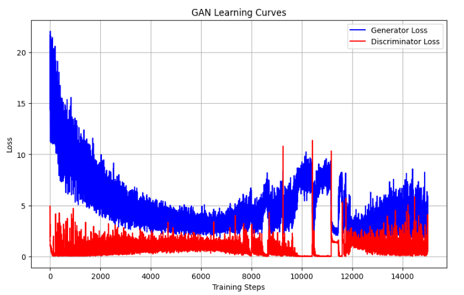

# CT-to-MRI Synthesis with Pix2Pix (TensorFlow/Keras) + Embedded DSP Export

Code from my final-year Electrical Engineering project at NUST EME. A conditional GAN (Pix2Pix: U-Net generator + PatchGAN discriminator) learns to translate 2D CT slices into T1-weighted MRI-like slices. The trained generator was exported to C headers and run on a Texas Instruments DSP board at roughly 5 FPS within about a 5 W power budget.

> **Data is not included.** The project used a paired CT/MRI research dataset that cannot be redistributed. Notebooks reference a Google Drive mount (`/content/drive/MyDrive/...`). Point the paths at your own paired NIfTI data.

## What the code does

1. **Preprocessing.** Loads paired CT and T1w volumes (`.nii` / `.nii.gz`, via nibabel), extracts 2D slices, resizes them to 256×256, normalizes, and saves the tensors.
2. **Input pipeline.** `tf.data` loaders for paired input/target images, with shuffling, batching and prefetching.
3. **Model.** A Pix2Pix generator (U-Net encoder-decoder with skip connections) and a PatchGAN discriminator, trained with adversarial + L1 loss in TensorFlow/Keras. The full layer summary is in [`model/model_architecture.txt`](model/model_architecture.txt).
4. **Evaluation.** Visual comparison of the CT input, generated MRI and ground truth, plus SSIM/PSNR computation in the notebook.
5. **Embedded export.** Dumps layer weights from the `.h5` model to `.npy`, converts them to C header arrays, verifies the generated headers, and converts a test volume into a C array for on-device inference.



## Repository layout

```
notebooks/
  01_pix2pix_training_749_epochs.ipynb   preprocessing + full Pix2Pix training
  02_pix2pix_training_drive_loader.ipynb training with tf.data loading from Drive
  03_training_run_01.ipynb               training run 1
  04_training_run_02.ipynb               training run 2
  05_keras_to_c_headers_for_dsp.ipynb    Keras -> .npy -> C header export for the DSP
model/
  model_architecture.txt                 Keras model summary
  h5py_model_config.json                 model config extracted from the .h5 file
assets/
  gan_learning_curves.png                generator / discriminator loss
```

Notebook outputs are cleared. No medical images, datasets or trained weights are included in this repo.

## Running

The notebooks were written for Google Colab with a GPU runtime.

1. Open a notebook in Colab, mount your Drive, and edit the dataset paths.
2. Install extras if needed: `pip install nibabel`. TensorFlow, NumPy and Matplotlib come preinstalled on Colab.
3. Run the cells in order: preprocessing, training, then evaluation. Use notebook 05 to export weights to C headers.

## Stack

Python · TensorFlow / Keras · NumPy · nibabel · Matplotlib · Google Colab · C (TI DSP deployment)

## License

MIT
